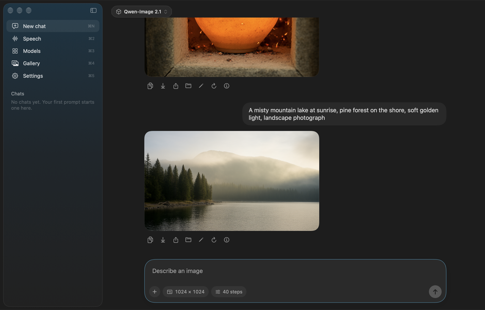
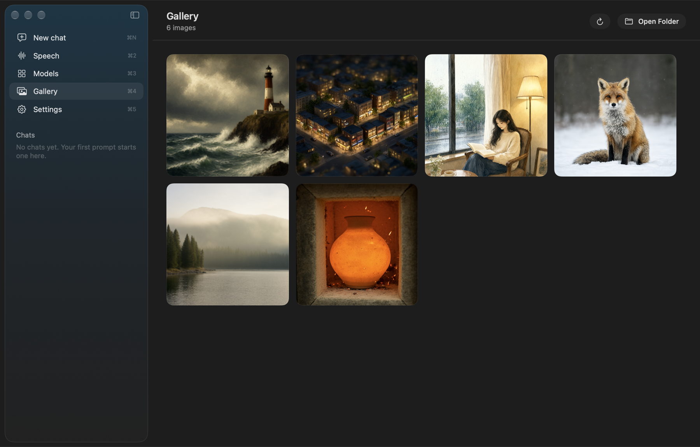
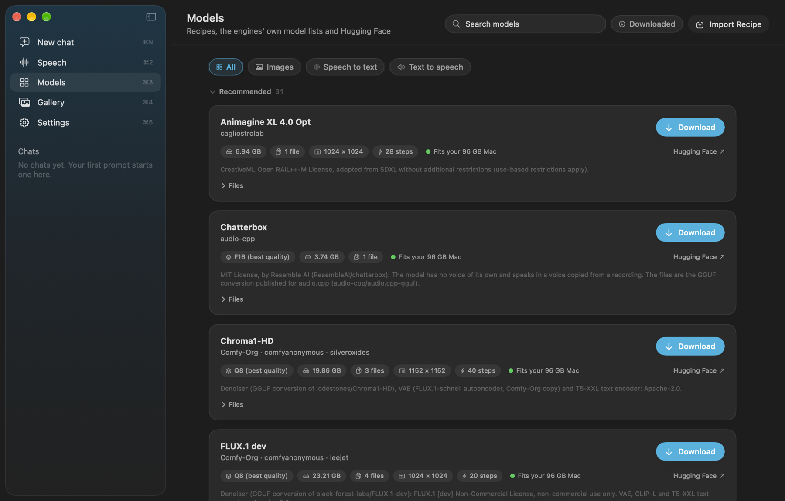
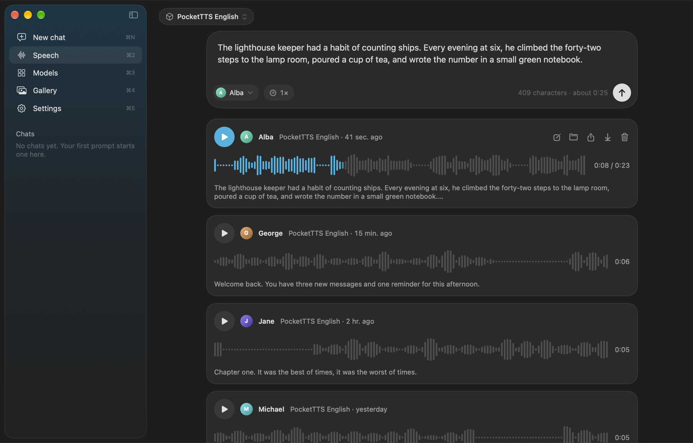

# Kiln

Kiln is a native macOS app that downloads models from Hugging Face and runs them on your own Mac. It makes images with [stable-diffusion.cpp](https://github.com/leejet/stable-diffusion.cpp), turns speech into text with [whisper.cpp](https://github.com/ggml-org/whisper.cpp), reads text aloud with [audio.cpp](https://github.com/0xShug0/audio.cpp) and makes 3D objects from pictures with [trellis.cpp](https://github.com/pwilkin/trellis.cpp).

It is for people with an Apple Silicon Mac who want to try image, speech and 3D models locally without setting up Python or a command line. It is written in Swift 6 and SwiftUI and is MIT licensed.



<p>
  
  
</p>



The images in these screenshots were generated in Kiln with the Qwen-Image 2.1 Turbo Uncensored recipe. The clips on the Speech screen are sample clips made for the screenshot.

## What it can do

Images:

- **Text to image.** Each prompt and its image form a turn in a chat. Chats are saved and listed in the sidebar, where they can be renamed, archived and deleted.
- **Image to image.** Attach an image with the plus button, by dropping a file on the composer, or with "Edit this image" on a result. Three strengths: Subtle, Balanced and Strong.
- **Step preview.** While an image is sampling, a rough preview is shown when the model can provide one.
- **Gallery.** Every image is a plain PNG with its prompt and settings embedded. "Reuse Settings" loads them back into the composer, including the seed.

Speech to text:

- Pick a Whisper model on the Generate screen, attach an audio file and send it. The transcript appears in the chat. An optional prompt lists names or words to expect.

Text to speech:

- **Speech screen.** Type or paste text, choose a voice (each one can be heard first) and send. Every clip is a card with a waveform to scrub through, the text it came from, a playback speed, and save, share and delete. Each clip is saved as a WAV file. Voice models can also be used from a chat.
- **Scripts with several speakers.** A line that starts with a name and a colon, such as `Anna: Did you hear that?`, begins that speaker's turn. Every voice model reads a script: a model made for conversations takes the whole script in one take, and the others read it line by line and Kiln joins the sound.
- **A voice per speaker.** The "Speakers" chip lists the speakers of a script, and each one is given a voice.
- **Your own voices.** With a model that can copy a voice, add a recording of one person speaking and the model reads in that voice. The first fifteen seconds are used.
- **Designed voices.** Describe a voice and a model that can make one up speaks a sample. Keep it, and every model that copies voices can speak in it.
- **Marks and notes.** A sound is written in the text as one word in brackets, such as `[laughs]`. Kiln rewrites it to the model's own tag, for example `[laughter]`, and leaves it out for a model that has no such sound. A note after a speaker's name says how a line is said: `Anna (whispering): …`. A model that can be directed also gets a Style control, and no model gets a control it does not support.

3D objects:

- **Picture to 3D.** On the 3D screen, choose or drop a picture of one object and send it. The result is a textured object that can be turned, zoomed and looked at in colour, as plain clay or as a wireframe.
- **Description to 3D.** With an image model installed, describe the object instead. Kiln draws a picture first and shows it for approval, then makes the object from it.
- **Make 3D from an image.** A generated image, in a chat or in the gallery, has a "Make 3D" button that takes it to the 3D screen.
- **Detail and settings.** Three levels of detail (Standard, Fine, Ultra, where the model has them), and under "Advanced" the seed, steps, guidance, how the object is cut out of its picture and the texture size.
- **Keeps working in the background.** While an object is being made, earlier ones can be looked at; the new one is marked when it is ready.
- **Export.** Save an object as GLB, USDZ or OBJ. Each object is kept as a GLB file with its settings beside it.

All speech models:

- **Language.** A model that works in several languages gets a language menu listing what it supports, with "Auto" first.

Models:

- **Curated recipes.** A recipe is a JSON file that lists every file a model needs, pinned to a commit, a size and a SHA-256, with its recommended settings. A recipe is one click to download. The 33 recipes in [`recipes/`](recipes) are listed below.
- **More models.** Most of the generated entries have never been run. MOSS-TTS-Nano, Soprano (on the CPU, after crashing on the GPU) and Whisper Tiny were downloaded and run, and their output transcribes back to the input. An untested entry may fail to load or need a setting Kiln does not offer.
- **Search.** The search field matches Kiln's own models by name or by the Hugging Face repo their files come from. A repo id such as `owner/name`, or a pasted link to its page, finds that repo on Hugging Face.
- **Hugging Face list.** The Models screen lists the most downloaded text-to-image repos and searches the Hub. Each repo shows its `.safetensors` and `.gguf` files, which can be downloaded one at a time.
- **Downloads.** Resumable, checked against the pinned size and SHA-256, with pause and cancel. A file that has no checksum is not downloaded. A downloads panel in the sidebar shows progress, speed and time left.
- **Memory-fit label.** Each recipe and Hub file is marked as fitting, tight or too large for this Mac. For a recipe with several quantizations, the app offers the largest one that fits comfortably and lets you switch.
- **Unload the model.** Frees the memory held by the loaded model.
- **Optional Hugging Face token** for gated models, stored in the macOS Keychain.

### Curated recipes

| Kind | Recipe ids |
| --- | --- |
| Images (19) | `animagine-xl-4.0`, `chroma1-hd`, `flux.1-dev`, `flux.1-schnell`, `flux.2-klein-4b`, `flux.2-klein-9b`, `flux.3-image-klein`, `juggernaut-xl-v9`, `noobai-xl-1.1`, `qwen-image-2.1-turbo-uncensored`, `qwen-image-2.1-turbo`, `qwen-image-2.1`, `qwen-image`, `realvisxl-v5.0`, `sd-1.5`, `sd-3.5-large`, `sdxl-base-1.0`, `sdxl-turbo`, `z-image-turbo` |
| Speech to text (5) | `whisper-base`, `whisper-large-v3-turbo`, `whisper-large-v3`, `whisper-medium`, `whisper-small` |
| Text to speech (7) | `chatterbox`, `omnivoice`, `pocket-tts-english`, `qwen3-tts-1.7b-base`, `qwen3-tts-1.7b-customvoice`, `vibevoice-1.5b`, `voxcpm2` |
| 3D objects (2) | `pixal3d`, `trellis-2` |

What the curated voice recipes can do differs:

- `pocket-tts-english` and `qwen3-tts-1.7b-customvoice` speak in voices of their own.
- `omnivoice` designs a voice from a description, copies one from a recording, and understands sound marks.
- `chatterbox` and `qwen3-tts-1.7b-base` speak only in a voice copied from a recording; `voxcpm2` can copy one.
- `vibevoice-1.5b` reads a whole script in one take, with up to four speakers.

Only some of these recipes have been run; see Status.

## Install

Kiln needs an Apple Silicon Mac with macOS 14 or later (only macOS 27 has been tested; see Status).

With [Homebrew](https://brew.sh):

```sh
brew install --cask nomansheikh/tap/kiln
```

Or download `Kiln-<version>.dmg` from the [Releases page](https://github.com/nomansheikh/kiln/releases/latest), open it and drag Kiln to Applications. The app is signed with a Developer ID and notarized by Apple.

To update, run `brew upgrade --cask kiln`, or download the newer disk image. Kiln says when a newer version has been published; it does not update itself.

To remove it, run `brew uninstall --cask kiln` or drag the app to the Trash. Your models, images, clips and voices stay in `~/Library/Application Support/Kiln/`. Adding `--zap` to the Homebrew command removes them too.

## Privacy and safety

- **Everything runs locally.** Models run in helper processes on your Mac. Prompts, recordings, voices, images and clips are not uploaded.
- **Network requests.** Kiln talks to `huggingface.co` to list, search and download models, to `raw.githubusercontent.com` at most once a day to fetch the curated recipes of this project, and to `api.github.com` at most once a day to ask whether a newer version of Kiln has been published. A download can be redirected by Hugging Face to another host that serves the file. Kiln makes no other requests: there is no account, no analytics and no crash reporting. Links to model pages and to this repository open in your browser.
- **The daily recipe fetch** carries no token and no information about you. Fetched recipes are validated, and every file they name is still checked against its SHA-256.
- **The check for a new version** carries no token and no information about you either, downloads and installs nothing, and can be turned off in Settings. When a newer version exists, a note in the sidebar links to its page.
- **The Hugging Face token** is optional. It is stored in the login Keychain and sent only to `huggingface.co`, never to a host a download is redirected to.
- **Deleting goes to the Trash.** Deleting a clip, a voice or an image moves its file to the Trash, so it can be put back from the Finder.
- **Voices.** Only add a voice you have the right to use. A copied voice can pass for the real person.
- **Model files are third-party data.** A checksum confirms that a file is the one the recipe names. It does not make the file safe. Download models only from sources you trust.
- **The helpers are confined.** Each helper that reads a model file enters a sandbox first: it cannot use the network, start another program, read your files outside the models folder, or write outside its scratch folder. [SECURITY.md](SECURITY.md) says what this does and does not cover.

How to report a vulnerability, and what is in scope, is in [SECURITY.md](SECURITY.md).

## Status

Kiln is early. Read this before relying on it.

- **Releases.** Version 0.1.0 is a signed, notarized disk image on the [Releases page](https://github.com/nomansheikh/kiln/releases), also installable with Homebrew from the maintainer's own tap ([nomansheikh/homebrew-tap](https://github.com/nomansheikh/homebrew-tap)); Kiln is not in Homebrew's official list. How a release is made is in [docs/releasing.md](docs/releasing.md). The app says when a newer version is published but does not update itself. There is no Intel build.
- **Two test machines.** Development and everything below was done on the maintainer's Mac, an Apple M5 Ultra with 96 GB of memory, on macOS 27.2. The notarized 0.1.0 build was also installed from its disk image on a Mac mini (Apple M4, 16 GB, macOS 27.0.1), where an image, a transcript and a spoken clip were each made. Kiln is built for macOS 14 and later, but no version older than macOS 27 has been tried. The helpers' sandbox with the GPU is the part most likely to behave differently on an older system.
- **Images.** The Stable Diffusion XL Base 1.0 recipe has been downloaded and run end to end through the app, and it is the only recipe marked `"tested": true`. The screenshots above were made with the Qwen-Image 2.1 Turbo Uncensored recipe. The other image recipes pass the file check (`python3 scripts/recipe.py check`), which shows that their files exist and match. It does not show that they generate an image.
- **Speech to text.** The Whisper Large v3 Turbo recipe has been downloaded and has transcribed a recording through the app. Cancelling a transcription and long recordings have not been tried.
- **Text to speech.** PocketTTS English has been used through the app, and its output transcribes back to the input text. OmniVoice and VibeVoice 1.5B have been run through the engine: OmniVoice with style words, sound marks, a designed voice and copied voices, and VibeVoice with a script, with and without copied voices. Chatterbox, Qwen3-TTS 1.7B Base and VoxCPM2 pass the file check only. Long texts have not been tried.
- **More models.** Most of the 71 generated entries have never been run. MOSS-TTS-Nano, Soprano (on the CPU, after crashing on the GPU), Qwen3-TTS CustomVoice (now a curated recipe), VibeVoice 1.5B and Whisper Tiny were downloaded and run, and their output transcribes back to the input. An untested entry may fail to load or need a setting Kiln does not offer.
- **Own voices, designed voices and scripts.** A script has been read line by line with PocketTTS (through the app) and with OmniVoice using a designed voice per speaker, and in one take with VibeVoice; the results transcribe back to the script. Whether a copied or designed voice sounds like its source was judged from pitch measurements, not by a listening test.
- **Image to image and the step preview** are implemented and unit-tested at the protocol level. They are not confirmed with a real model.
- **3D objects.** TRELLIS.2 (the Q4 files) and Pixal3D have each made objects through the app. Measured with the engine's command-line tool on the M5 Ultra, a Fine object takes about eight to nine minutes and about 8 GB of memory with either model; Standard with TRELLIS.2 takes about three minutes and 6 GB. Ultra detail has not been run with either model, the larger TRELLIS.2 file sets (Q8 and full precision) have not been downloaded, and neither model has been run on a 16 GB Mac. Saving as USDZ and OBJ has not been checked in another program.
- **Tests.** The core library has unit tests (`swift test`), and the app's stores have their own, run by `xcodebuild`. The views have none.
- **CI.** A GitHub Actions workflow runs on every pull request and every push to `main`: a conventions check, the recipe check against Hugging Face, and a build job that runs the core tests, builds the four helpers, builds the app and runs the store tests. The built helpers are cached between runs.

Known limits:

- One model is in memory at a time, and one screen generates at a time.
- The memory-fit label is a heuristic based on file sizes. It does not count the memory a generation needs on top of the weights.
- trellis.cpp cannot stop a run in progress or report one. Stopping an object ends its helper, and the model is loaded again for the next one.
- A 3D object is made from one picture of one object. What the picture does not show, the model makes up.
- audio.cpp cannot stop a run in progress. A stopped clip ends for the app at once; the helper is ended if the run has not finished within a few seconds.
- Not every audio.cpp model works on the GPU. A speech model that brings its helper down on the GPU is run again on the CPU.
- A model that reads a whole script in one take has a limit on speakers (four for VibeVoice) and ignores per-line notes.
- A script read line by line has no flow between the lines: each one is generated by itself and the sound is joined.
- Transcripts have no timestamps.
- The Hugging Face list holds text-to-image repos only. Downloading one file from it gives a runnable model for all-in-one checkpoints (for example SD 1.5 or SDXL `.safetensors`) and for other versions of a model Kiln has a recipe for, which borrow that recipe's other files and settings untested. Any other model split into several files needs a recipe.
- Text-to-speech models that need eSpeak, or that are split over several weight files, are not offered.
- There is no button to remove a recipe, and Kiln does not delete the copies it keeps of attached files.
- Not implemented: video, training, LoRA, and models that need a vision projector.

## Build from source

You need:

- an Apple Silicon Mac running macOS 14 or later
- Xcode 16 or later (Swift 6)
- CMake and XcodeGen: `brew install cmake xcodegen`

```sh
git clone --recursive https://github.com/nomansheikh/kiln.git
cd kiln

# If you cloned without --recursive:
git submodule update --init --recursive

brew install cmake xcodegen

# Build the four helpers (output: build/engine/kiln-engine, build/whisper/kiln-whisper, build/audio/kiln-audio and build/trellis/kiln-trellis)
./scripts/build-engine.sh

# Generate Kiln.xcodeproj from project.yml
xcodegen generate
```

Then open `Kiln.xcodeproj` in Xcode and run the `Kiln` scheme, or build from the command line with the line CI uses:

```sh
xcodebuild -scheme Kiln -configuration Debug -destination 'platform=macOS,arch=arm64' CODE_SIGNING_ALLOWED=NO test
```

Run the core library tests with:

```sh
swift test
```

Building a disk image without a Developer ID is described in [docs/releasing.md](docs/releasing.md).

### Repository layout

| Path | Contents |
| --- | --- |
| `App/` | SwiftUI app: `Stores/`, `Features/`, `Shell/`, `DesignSystem/`, `Support/` |
| `Sources/KilnCore/` | UI-free core library: recipes, Hugging Face client, downloads, engine clients, gallery, audio, 3D objects, chats |
| `Engine/` | The four C++ helpers: `kiln-engine` (stable-diffusion.cpp), `kiln-whisper` in `whisper/` (whisper.cpp), `kiln-audio` in `audio/` (audio.cpp) and `kiln-trellis` in `trellis/` (trellis.cpp) |
| `recipes/` | Curated recipes bundled into the app |
| `catalog/` | Generated lists of models that have no recipe (`scripts/catalog.py`) |
| `Tests/` | Unit tests for KilnCore, and tests of the app's stores |
| `docs/` | Architecture, recipe reference and the release process |
| `scripts/` | Recipe, catalogue, build and release scripts |
| `Vendor/stable-diffusion.cpp`, `Vendor/whisper.cpp`, `Vendor/audio.cpp`, `Vendor/trellis.cpp` | Git submodules |

## How it works

- A recipe names the files a model needs on Hugging Face and its settings.
- `DownloadManager` fetches each missing file into `<file>.partial`, resumes with HTTP `Range` requests, verifies size and SHA-256, then moves the file into place.
- Each engine runs in its own helper process: `kiln-engine` for images, `kiln-whisper` for speech to text, `kiln-audio` for text to speech and `kiln-trellis` for 3D objects. A crash in a helper does not take the app down.
- The app and a helper exchange one JSON object per line over stdin and stdout. A helper keeps its model loaded between requests.
- A finished image is written as a PNG into the gallery folder with its settings embedded in text chunks. A finished clip is written as a WAV file with a JSON file of its settings beside it, and a finished 3D object as a GLB file with one.

Details, including the helper protocol, are in [docs/architecture.md](docs/architecture.md).

## Where files are stored

Everything except the cache of voice samples lives under `~/Library/Application Support/Kiln/`:

| Path | Contents |
| --- | --- |
| `models/<owner>/<repo>/<file>` | Downloaded model files |
| `gallery/*.png` | Generated images. Settings are embedded in two text chunks: `parameters` (readable text) and `kiln` (JSON). |
| `audio/*.wav` | Generated sound, each with a JSON file of its settings beside it |
| `voices/` | Your own voices: the recordings you added and the voices you designed |
| `chats/<uuid>.json` | Saved chats, one file each |
| `attachments/` | Copies of files attached to prompts |
| `recipes-remote/<id>.json` | Curated recipes fetched from this repository, at most once a day |
| `recipes/<id>.json` | Recipes you imported, and the recipes created when you download one file from the Hugging Face list |

Voice samples, made the first time you listen to a voice, are kept in `~/Library/Caches/Kiln/voice-samples/`.

The Hugging Face access token is stored in the macOS Keychain, not in these folders. Deleting a chat does not delete its images or attachments.

## Contributing

The most useful contribution is a model recipe. A recipe is one JSON file in `recipes/`: the Hugging Face files to download, the role each one plays, and the recommended settings. A script writes it for you, looking up each file's commit, size and SHA-256 without downloading anything:

```sh
python3 scripts/recipe.py new \
  --id sdxl-base-1.0 \
  --name "Stable Diffusion XL Base 1.0" \
  --component checkpoint=stabilityai/stable-diffusion-xl-base-1.0:sd_xl_base_1.0.safetensors \
  --steps 30 --cfg 7.0 --sampler euler --width 1024 --height 1024 \
  --license-note "CreativeML Open RAIL++-M License." \
  --min-memory-gb 16

python3 scripts/recipe.py check   # verifies every file against Hugging Face
```

You can also import a recipe file from the Models screen with "Import Recipe" without contributing it.

- How to contribute a recipe or a code change: [CONTRIBUTING.md](CONTRIBUTING.md)
- Field reference, speech recipes, variants and validation rules: [docs/recipes.md](docs/recipes.md)
- The same rules written for coding agents: [AGENTS.md](AGENTS.md)
- Conduct: [CODE_OF_CONDUCT.md](CODE_OF_CONDUCT.md)

## Licence

Kiln is released under the [MIT License](LICENSE). Third-party components and their licences are listed in [THIRD_PARTY.md](THIRD_PARTY.md).

Kiln does not bundle or distribute model weights. Every model has its own licence, and so does every voice. You are responsible for complying with them. Each curated recipe states the licences of its files in its `license_note`. Several are for non-commercial use only, for example the denoisers of `flux.1-dev`, `flux.2-klein-9b` and the three Qwen-Image 2.1 recipes, and the `omnivoice` model. The entries under "More models" are generated, licence notes included, so check a model's own page before relying on one.
